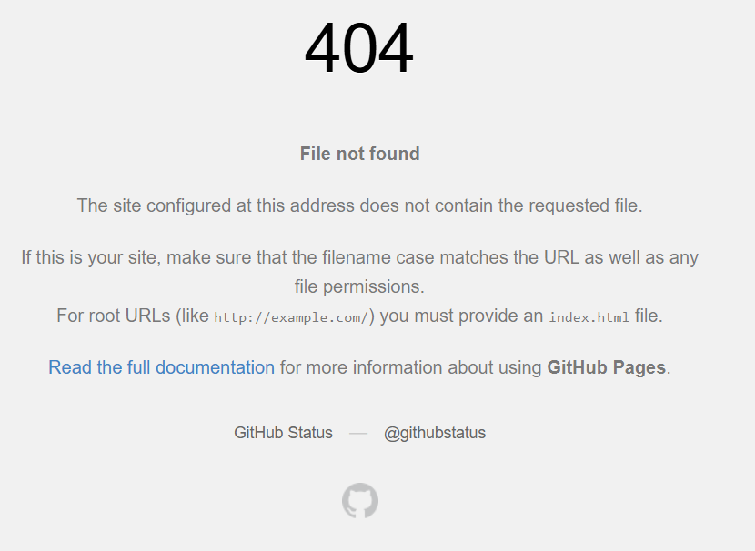
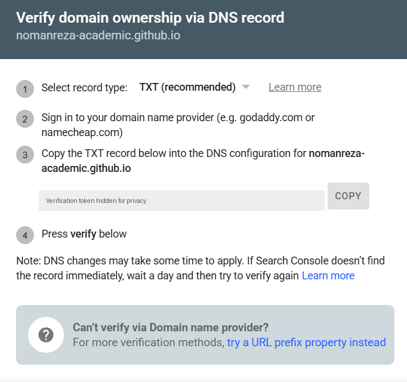
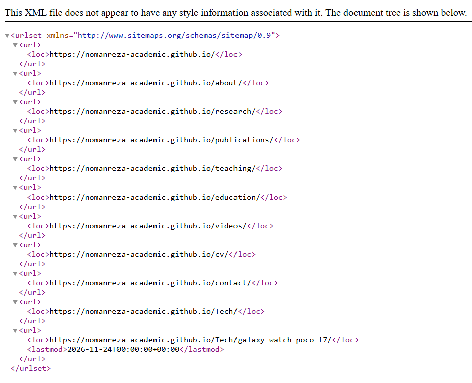
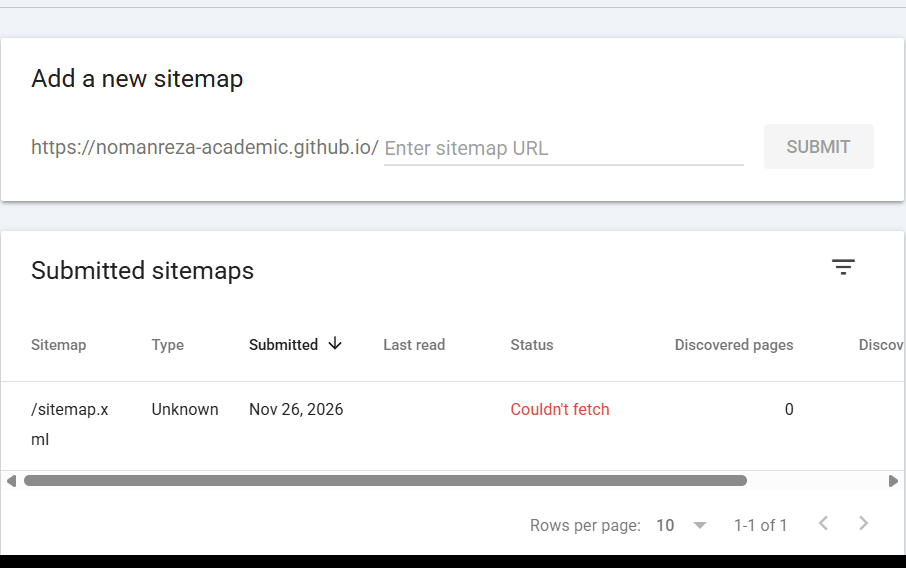
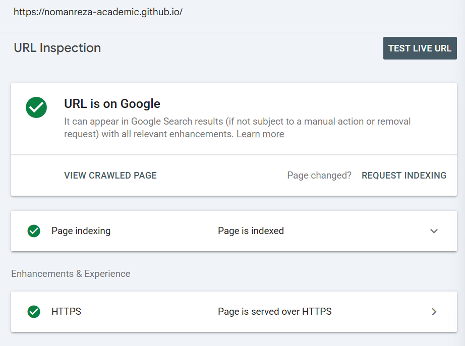

Have you ever wanted your own website but thought you needed to learn programming, buy a domain or pay for hosting? I had a similar goal: to create a place where I could share my academic profile, research, publications and technology tutorials.

I built my website with the help of ChatGPT, published it using GitHub Pages, added a blog with Pages CMS and verified it in Google Search Console. I also encountered a few errors along the way. In this guide, I will show you how to do the same, without assuming that you are a web developer.

**See my working example:** [My academic website](https://nomanreza-academic.github.io/)

**What you need:** a computer, internet access, a GitHub account and a Google account. You do not need to purchase a domain or hosting for a basic static site.

## Step 1. Decide what your website is for

Start small. If you are a student, create a portfolio of your projects. If you are a researcher, include your research, publications and CV. If you want to share knowledge, add a blog.

My website includes Home, About, Research, Publications, Teaching, Education, Videos, Tech, CV and Contact. You do not need all these pages on day one.

## Step 2. Build the website with ChatGPT

Open [ChatGPT](https://chatgpt.com/) and try this prompt. Replace the example details with your own.

```text
Create a professional personal portfolio website for me.
Include Home, About, Projects, Blog, CV and Contact.
Use HTML, CSS and JavaScript, with a mobile-friendly design.
Make the site compatible with GitHub Pages.
Add unique page titles, meta descriptions and descriptive links.
Use placeholders for my information rather than inventing it.
Provide the website files and clear publishing instructions.
```

Review the result, customize your details and open the local `index.html` in your browser if it is plain HTML. For Jekyll projects, preview after the build rather than expecting raw templates to work locally. Ask ChatGPT to explain anything you do not understand. Never upload passwords, API keys or confidential documents.

### Want a ready-made starting point?

[Download a free beginner website starter (ZIP)](/media/tech/website-guide/starter-website.zip). It includes a homepage, a sample blog, responsive CSS, Pages CMS configuration and automatic sitemap support. It is a generic example for a **new** website, not a copy of my personal site. Extract it, replace `YOUR-USERNAME` in `_config.yml` with your GitHub username, update the sample content and follow the next steps. This template has not been independently deployed; check the published pages after uploading.

## Step 3. Create your GitHub repository

Visit [GitHub](https://github.com/) and create a free account. Your username will be part of your website address, so choose it carefully.

1. Click the **+** menu and choose **New repository**.
2. Name it `yourusername.github.io`, replacing `yourusername` with your actual GitHub username.
3. Select **Public** and click **Create repository**.
4. Select **Add file → Upload files** and upload the extracted website files, preserving the folder structure. Commit the changes.

Make sure `index.html` is directly in the repository root, not inside an extra folder. Upload the extracted files, not the ZIP itself. If your project uses hidden files such as `.pages.yml`, make sure they are included; GitHub Desktop is useful for this.

## Step 4. Make your website live with GitHub Pages

Open your repository and go to **Settings → Pages**. Under Build and deployment, select:

| Setting | Choose |
| --- | --- |
| Source | Deploy from a branch |
| Branch | main (or your actual publishing branch) |
| Folder | / (root) |

Click **Save**, then check the **Actions** tab for a successful deployment. Open the published URL from Settings → Pages. It should look like `https://yourusername.github.io/`. Use HTTPS.



*If you get a 404 error, check the file location, filename capitalization, publishing branch and deployment status. This is a real example of a missing file from my setup.*

## Step 5. Add a blog you can manage without coding every time

I wanted to write future articles without manually creating HTML pages. For this, I use **Jekyll** (which turns Markdown articles into pages) and **Pages CMS** (which lets me edit the content through a web interface).

If you use the starter ZIP, the configuration is already included. If you have your own website, ask ChatGPT to add a Jekyll blog collection, reusable layout, blog listing and `.pages.yml` configuration to your existing files. Keep a backup first. Do not disable Jekyll using `.nojekyll` if you need it to build your blog.

1. Open [Pages CMS](https://app.pagescms.org/) and sign in with GitHub.
2. Authorize access to your repository and select it.
3. Open **Tech Blog → New entry** (the label depends on your configuration).
4. Enter a title, date, description, featured image and article content.
5. Save, then check the new article after GitHub Pages deploys.

You can see an example on [my Tech page](https://nomanreza-academic.github.io/Tech/). My first article was about fixing a Samsung Galaxy Watch pairing issue on POCO F7.

## Step 6. Add basic SEO to your website

A live website is not necessarily indexed by Google. Hosting makes your pages available; indexing adds them to Google's search database; ranking determines where they appear for a particular search.

Start with a descriptive page title and description. In a plain HTML site, add these inside the `<head>` section (replace the examples):

```html
<title>Your Name | Academic Portfolio</title>
<meta name="description" content="My research, projects and technology tutorials.">
<link rel="canonical" href="https://yourusername.github.io/">
```

Use a different title, description and canonical URL for each page. The starter's layout generates these from page settings. Also write useful content, describe images with alt text, link related pages together and check your site on a phone.

## Step 7. Verify your website in Google Search Console

Open [Google Search Console](https://search.google.com/search-console/) and choose **Add property → URL prefix**. Enter your full website URL including `https://`.



*My mistake: I first selected Domain verification. I did not control the DNS for github.io. Switching to URL prefix solved this problem.*

Choose **HTML file** verification. Download Google's verification file, upload it unchanged to your GitHub repository root and commit it. Once the file is publicly accessible after deployment, click **Verify** in Search Console. Keep the verification file in your repository.

## Step 8. Create robots.txt and sitemap.xml

These files help search engines discover your content. If you use the starter, they are generated by Jekyll and the `jekyll-sitemap` plugin; check that both URLs work. Do not create a second competing sitemap.

For a plain HTML website, create `robots.txt` in the repository root:

```text
User-agent: *
Allow: /

Sitemap: https://yourusername.github.io/sitemap.xml
```

Then create `sitemap.xml` in the same location:

```xml
<?xml version="1.0" encoding="UTF-8"?>
<urlset xmlns="http://www.sitemaps.org/schemas/sitemap/0.9">
  <url>
    <loc>https://yourusername.github.io/</loc>
  </url>
</urlset>
```

Replace the sample username in both files. Add another `<url>` entry for each real page you want indexed. With a Jekyll-generated sitemap, new eligible blog pages can be included automatically instead.

After deployment, open `/robots.txt` and `/sitemap.xml` on your website.



*My sitemap includes 11 URLs, including academic pages and my first Tech article. The browser message about missing style information is normal for XML.*

## Step 9. Submit your sitemap and fix common errors

In Search Console, select **Sitemaps**, enter `sitemap.xml` and click **Submit**.



*I initially received the “Couldn't fetch” error. My sitemap later opened correctly in the browser.*

If you get this error, open your sitemap directly, check for 404 errors or raw template code, confirm the URL is correct and check that crawlers are allowed. If you submitted it before deployment completed, submit it again once it is accessible. Google may take time to process it; check the report later. A working XML file does not by itself confirm that Google has processed it.

## Step 10. Request Google indexing

In Search Console, choose **URL inspection** and enter your homepage URL. If it is not indexed, select **Test live URL** and then **Request indexing** if eligible. Repeat for important pages or new articles.



*This was the result I received: “URL is on Google”, “Page is indexed” and HTTPS confirmed.*

You can also try searching `site:yourusername.github.io` on Google, but Search Console is better for confirming a particular URL. Indexing can take days or weeks, and it does not guarantee a high search ranking.

## What to do after your website is live

Keep your pages updated, add original articles and link your website from relevant professional profiles such as LinkedIn, ORCID or Google Scholar. Use Search Console's Performance report to see the queries and pages that receive impressions and clicks. You can also submit your site to [Bing Webmaster Tools](https://www.bing.com/webmasters/) if you wish.

My biggest takeaway is that you do not need to build a perfect website before publishing. Start with one page, get it online, then add features as you learn. The tools described here can help you create a professional online presence without paying for basic static hosting.

**Happy building!** If this guide helps you, share your website with others and keep improving it.

## Helpful official resources

- [GitHub Pages quickstart](https://docs.github.com/en/pages/quickstart)
- [Pages CMS quickstart](https://pagescms.org/docs/quick-start/)
- [Jekyll documentation](https://jekyllrb.com/docs/)
- [Google SEO Starter Guide](https://developers.google.com/search/docs/fundamentals/seo-starter-guide)
- [Google sitemap guide](https://developers.google.com/search/docs/crawling-indexing/sitemaps/build-sitemap)
- [Google URL Inspection guide](https://support.google.com/webmasters/answer/9012289)
