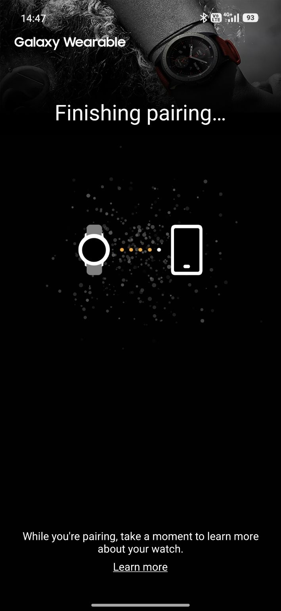
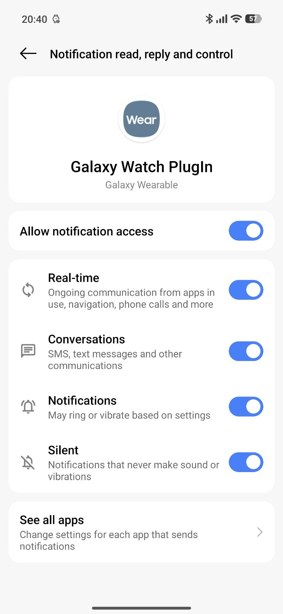
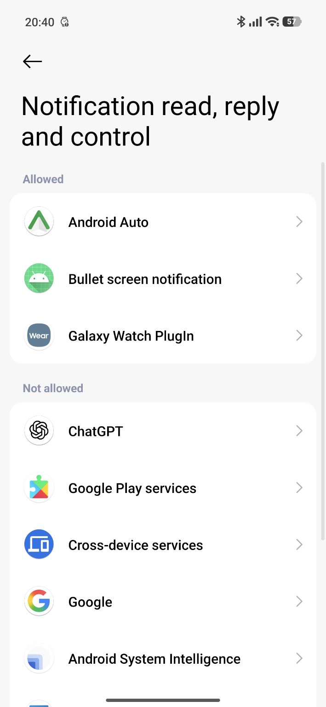
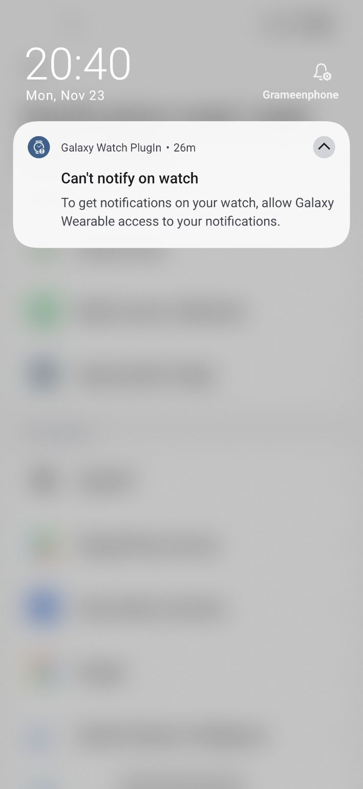

I recently tried connecting my original Samsung Galaxy Watch to my POCO F7. Despite granting permissions and removing battery restrictions, Galaxy Wearable remained stuck on **Finishing pairing…**. A single ADB command finally advanced setup, and my watch is now working.

## Tested devices

| Device | Details |
| --- | --- |
| Phone | POCO F7 (HyperOS) |
| Watch | Samsung Galaxy Watch 42mm LTE (2018), SM-R815F |
| Watch OS | Tizen |
| Companion | Galaxy Wearable and Galaxy Watch Plugin |
| Computer | Windows PC |



## 1. Check the usual settings first

Install Galaxy Wearable from Google Play and let it download the appropriate Galaxy Watch Plugin. Check Samsung Accessory Service if required. Under Settings → Apps → Manage apps, grant requested relevant permissions, including Nearby devices. Set battery saver to No restrictions for Wearable and its plugin; enable background autostart if available. Search Settings for Notification access or Notification read, reply and control, and enable the plugin. Restart both devices and initiate pairing from Galaxy Wearable, not Bluetooth settings.

In my case, notification access was already enabled, yet the warning persisted.







## 2. Download ADB

On Windows, download SDK Platform-Tools from the [official Android developer website](https://developer.android.com/tools/releases/platform-tools). Extract the ZIP and open the platform-tools folder. No rooting or bootloader unlocking is required.

## 3. Enable USB debugging

On the POCO F7, open Settings → About phone and tap the OS version seven times. Open Settings → Additional settings → Developer options and enable USB debugging. Connect the phone using a USB data cable, select File Transfer / Android Auto, unlock the screen and approve the USB debugging prompt on your trusted computer.

## 4. Verify the ADB connection

In the platform-tools folder, click the address bar, type `cmd` and press Enter. Run:

```bash
adb devices
```

Expected output (identifier is illustrative):

```text
List of devices attached
XXXXXXXX    device
```

Initially my device list was empty and no authorization prompt appeared. If this happens, revoke USB debugging authorizations in Developer options, toggle USB debugging off and on, disconnect and reconnect the unlocked phone, then approve the prompt if shown. Run:

```bash
adb kill-server
adb start-server
adb devices
```

If still empty, try another data cable or USB port and check Device Manager for the Android ADB interface or a missing driver. If it says `unauthorized`, approve the prompt. Continue only when the status is `device`.

## 5. Reproduce the pairing problem

Keep the phone connected to Windows. Open Galaxy Wearable, start pairing and wait until it gets stuck on Finishing pairing. Leave the app open.

## 6. Run the command that worked

```bash
adb shell am broadcast -a OOBE_FLOW_CONTINUE_REQUEST -p com.samsung.android.geargplugin
```

Wait 10–20 seconds and follow any remaining setup prompts. In my case, the command advanced pairing and the watch started working.

A possible command response is `Broadcast completed: result=0`. This only confirms broadcast completion, not successful pairing. Check the watch and app themselves.

The command sends a broadcast requesting continuation of the initial setup (out-of-box experience) to the older Galaxy Watch Plugin. The exact underlying cause of the stall is not established. This is an unofficial workaround and may skip an incomplete setup step.

## 7. Verify the connection

Check that Galaxy Wearable shows Connected, the normal watch face and settings are available, and the battery level appears. Test calls, SMS, WhatsApp notifications, Samsung Health synchronization and reconnection after toggling Bluetooth. If notifications fail, revisit notification access and the app notification settings. Disable USB debugging after testing.

## Frequently asked questions

**Does this require root?** No.

**Does it work on newer Galaxy Watches?** Not necessarily. Watch4 and later Wear OS models use different plugins. This guide is tested on SM-R815F only.

**Do I need to reset the watch?** Not necessarily; a factory reset erases watch data, so avoid repeated resets.

**Does this activate LTE/eSIM?** No. Carrier and regional support determine LTE activation.

## Conclusion

My POCO F7 and Samsung Galaxy Watch SM-R815F are now working together. I hope this guide saves others the time I spent troubleshooting. Results may vary by software version and device model.
